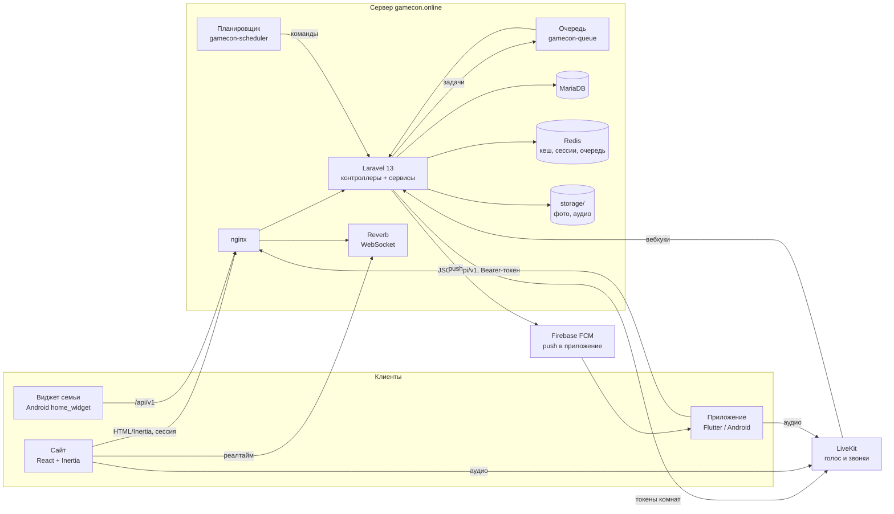
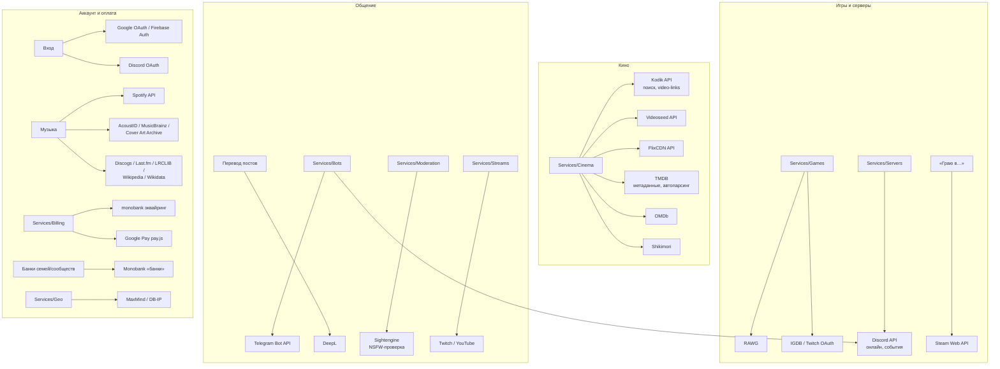
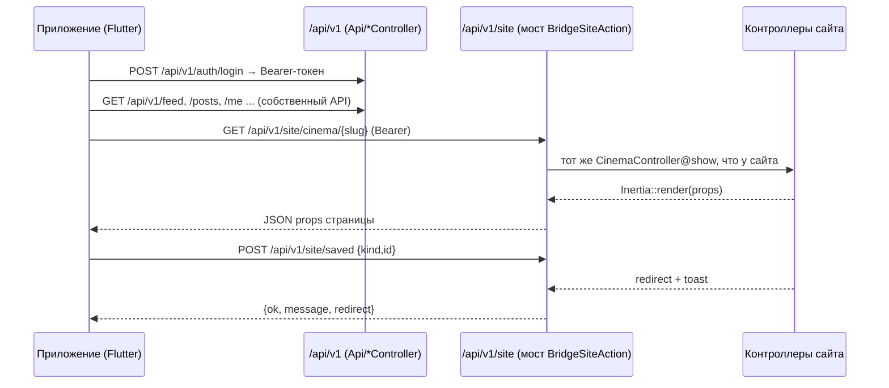

# GameCon — как устроен проект

GameCon (gamecon.online) — социальная сеть для геймеров в духе ВКонтакте: лента, профили, друзья,
сообщения, сообщества, музыка, кино, GTA RP‑серверы, семьи и кланы, голосовые комнаты, звонки,
совместный просмотр и прослушивание. Есть **веб‑сайт** и **Android‑приложение** (Flutter). Оба работают
с **одним и тем же бэкендом** и одной базой: всё, что делается в приложении, видно на сайте, и наоборот.

> Секреты и ключи описаны отдельно: [docs/SECRETS.md](SECRETS.md). Правила для ИИ‑агентов: [AGENTS.md](../AGENTS.md).

---

## 1. Стек

| Часть          | Технологии                                                                                                                                                                                                                            |
| -------------- | ------------------------------------------------------------------------------------------------------------------------------------------------------------------------------------------------------------------------------------- |
| Бэкенд         | PHP 8.3+, **Laravel 13**, Fortify (вход, 2FA, passkeys), Reverb (WebSocket), очереди и кеш в Redis, БД MariaDB                                                                                                                        |
| Веб‑клиент     | **Inertia.js + React 19 + TypeScript**, Vite, Tailwind CSS 4, Radix UI, иконки Lucide, Wayfinder (типизированные маршруты), Laravel Echo (реалтайм)                                                                                   |
| Приложение     | **Flutter** (Dart 3), go_router, http, just_audio + audio_service (музыка в фоне), video_player (свой плеер кино), webview_flutter (плееры балансеров), livekit_client (голос), firebase_messaging (push), home_widget (виджет семьи) |
| Голос и звонки | LiveKit (отдельный сервер, конфиг в `deploy/livekit`)                                                                                                                                                                                 |
| Push           | Firebase Cloud Messaging (приложение) + Web Push VAPID (сайт)                                                                                                                                                                         |
| Сервер         | Ubuntu, nginx, PHP‑FPM, systemd‑сервисы `gamecon-queue`, `gamecon-reverb`, `gamecon-scheduler` (см. `deploy/`)                                                                                                                        |
| CI             | GitHub Actions: `tests.yml` (сайт), `app-build.yml` (APK + AAB), `app-audio-check.yml` (фоновое аудио на эмуляторе)                                                                                                                   |

---

## 2. Структура репозитория

```
app/
  Http/Controllers/         контроллеры сайта (они же — для приложения через «мост», см. §4)
  Http/Controllers/Api/     собственный JSON‑API приложения (/api/v1/...)
  Http/Controllers/Admin/   админ‑панель (/admin)
  Http/Middleware/          BridgeSiteAction (мост), AuthenticateApiToken, EnsureModuleEnabled, ...
  Services/                 бизнес‑логика по разделам: Cinema/, Families/, Push/, Voice/, Billing/, ...
  Jobs/                     фоновые задачи (очередь Redis)
  Console/Commands/         команды планировщика (routes/console.php)
  Support/Settings/         SiteSettings — настройки сайта и секреты интеграций (из админки)
  Support/Modules/          ModuleManager — включение/выключение разделов
  Support/Plugins/          Plugins — мелкие функции‑переключатели (top_ten, server_compare, ...)
config/services.php         адреса внешних API и ключи из .env (запасной вариант к настройкам админки)
database/migrations/        схема БД (только новые миграции, старые не редактировать)
resources/js/pages/         страницы сайта (Inertia), resources/js/components — компоненты
routes/web.php              маршруты сайта
routes/api.php              API приложения: /api/v1/* и мост /api/v1/site/*
routes/console.php          расписание фоновых команд
lang/catalog.json           каталог строк для переводов (генерируется скриптом)
mobile/                     Flutter‑приложение
  lib/                      экраны и логика (см. §5)
  android/                  нативная часть Android (Kotlin: виджет, FrameScriptPlugin, PlayingDetector)
deploy/                     всё для сервера: nginx, systemd, php.ini, LiveKit, почта, скрипты деплоя
tests/Feature/              тесты сайта и моста (PHPUnit)
mobile/test/                тесты приложения (flutter test)
scripts/i18n/               извлечение строк для переводов
docs/                       эта документация, backlog.md, сверка сайта и приложения
```

---

## 3. Карта связей

### 3.1. Общая схема



### 3.2. Внешние сервисы по разделам



### 3.3. Как приложение ходит на сервер



---

## 4. Бэкенд: главное

### 4.1. Три входа в одни и те же данные

1. **Сайт** — `routes/web.php`, сессия и cookie, ответы через `Inertia::render('страница', props)`.
2. **API приложения** — `routes/api.php`, префикс `/api/v1`, авторизация `Authorization: Bearer <токен>`
   (`AuthenticateApiToken`, токены выдаёт `App\Services\Auth\ApiTokens`).
3. **Мост** `/api/v1/site/*` — middleware `BridgeSiteAction`. Приложение вызывает **те же контроллеры,
   что и сайт**, без дублирования логики:
    - GET страницы → JSON её props;
    - действие с `back()`/redirect + toast → `{ ok, message, redirect }`;
    - ошибки валидации → обычный JSON 422.

    ⚠️ **Маршрут сайта не появляется в мосте сам.** Каждый путь, который нужен приложению, надо явно
    добавить в группу `Route::prefix('site')` в `routes/api.php` (тот же контроллер, тот же путь).
    Если забыть — приложение покажет «Цей розділ запрацює після оновлення сайту» (это 404 маршрута).
    Проверка: `tests/Feature/AppSiteParityTest.php`.

### 4.2. Разделы, модули, плагины

- **Модули** (`ModuleManager`, middleware `module:<имя>`) включают/выключают целые разделы:
  feed, friends, people, messages, communities, photos, music, cinema, servers, families, games, clans,
  events, party, moments, quests. Выключенный модуль даёт 404 и на сайте, и в приложении.
- **Плагины** (`Support/Plugins/Plugins`) — мелкие функции внутри разделов (`top_ten`, `server_compare`,
  `not_interested`, `mute_author`, …). Проверка в контроллере: `app(Plugins::class)->ensure('ключ')`.
- **Настройки сайта** (`SiteSettings`) редактируются в админке и кешируются (`site.settings`).

### 4.3. Кино (самый «хрупкий» раздел)

```mermaid
flowchart LR
    AUTO[Автозаполнение<br/>CinemaAutoImport, TmdbAutoParse] -->|import| CS[CinemaService::import]
    ADMIN[Админка: импорт, «Оновити»] --> CS
    BULK[Общая проставка<br/>BulkPlayers + AssignCinemaPlayers] -->|mergeSources| CS
    CS -->|после импорта| JOB[Job RefreshMoviePlayers]
    OPEN[Открытие тайтла<br/>CinemaController] -->|due() → раз в 3 дня| JOB
    JOB -->|fetchPlayers по всем ID| P[Kodik / Videoseed / FlixCDN]
    JOB -->|mergeSources: только добавить| SRC[(movie_sources)]
```

Правила, которые нельзя ломать:

- Тайтл хранит озвучки в `movie_sources` (provider + external_id). **Импорт и обновление только
  добавляют и обновляют.** Пропавшая у провайдера озвучка получает `missing_since` и удаляется лишь через
  `MovieSource::RETIRE_DAYS` (30) дней отсутствия. Пустой ответ провайдера не удаляет ничего.
- После любого импорта ставится `RefreshMoviePlayers`: он ищет тайтл во всех провайдерах по всем ID
  (Кинопоиск, IMDb, Shikimori, TMDB) и добавляет все озвучки.
- Скрытые админом озвучки (`is_hidden`) и порядок не трогаются автоматикой. Свои плееры — provider `custom`.
- Прогресс просмотра: `movie_user` (`season`, `episode`, `position`, `player_key`).
- Плеер приложения: `/cinema/{movie}/stream` → прямые HLS‑ссылки через партнёрский метод Kodik
  `video-links` (ключ — в админке, см. SECRETS.md). Нет ключа или ссылки → веб‑плеер балансера
  в WebView (`/play/embed`). **Не обходить защиту балансеров** (расшифровка ссылок, подделка подписей,
  перехват потоков) — только официальные методы.

### 4.4. Фоновые процессы

- Очередь: `Jobs/*` (push, обновление плееров, проставка плееров, разбор треков через ffmpeg — `ProcessTrackAudio`, …). Сервис `gamecon-queue`; ffmpeg ставит `deploy/remote.sh`.
- Метаданные треков: `ProcessTrackAudio` (ffprobe, без него — getID3 `Music/Id3Probe`) → `EnrichTrackMetadata` →
  `Music/MetadataEnricher`. Источники работают вместе: теги файла, AcoustID (отпечаток `fpcalc`, Chromaprint) →
  MusicBrainz, поиск MusicBrainz, Discogs, Spotify, Last.fm, Cover Art Archive, LRCLIB; для каждого поля побеждает
  значение с наибольшим доверием (`Music/MetaMatch`, совпадение источников — бонус). Происхождение полей —
  `tracks.metadata_meta`; заданное пользователем (`user`) автоматика не меняет. «Про исполнителя» (`Music/ArtistInfo`)
  сверяет личность через MBID ↔ Wikidata и ссылки MusicBrainz на Spotify/Discogs. Догрузка: `php artisan music:enrich`
  или Админка → Музыка → «Оновити метадані». `MUSIC_METADATA=false` отключает внешние запросы (так в тестах).
- Планировщик (`routes/console.php`, сервис `gamecon-scheduler`): `cinema:sync`, `servers:sync`,
  `families:tick`, `posts:publish`, `events:remind`, `events:sync`, `discord:presence`, `steam:presence`,
  `billing:tick`, `streams:check`, `games:sync`, `i18n:translate`, `geoip:update`, …
- Реалтайм: Reverb (сервис `gamecon-reverb`), на сайте — Laravel Echo.

### 4.4.0. GameCon+ в приложении (Google Play Billing)

- Приложение продаёт GameCon+ **только через Google Play Billing** (`mobile/lib/play_billing.dart`, пакет
  `in_app_purchase`): цены и планы — из Google Play, сервер отдаёт лишь ID подписок и `account_id`
  (`GET /api/v1/google-play`, он уходит в obfuscatedAccountId). Никаких ссылок на оплату на сайте (anti-steering).
- Токен покупки → `POST /api/v1/google-play/verify` → `Services/Billing/GooglePlay::sync`: состояние, срок и
  владелец берутся из Google Play Developer API (subscriptionsv2), покупка подтверждается (acknowledge),
  доступ — `plus_grants` с `subscription_id` (таблица `plus_subscriptions`). Доверять данным из приложения нельзя.
- Продления/отмены/возвраты: RTDN (Pub/Sub push на `/billing/google-play/rtdn?token=…`, секрет
  `google_play_rtdn_token`) и `billing:tick` (перечитывает истекающие подписки).
- Настройки: Админка → Інтеграції → Google Play (ключ — секрет `google_play_service_account` или ключ Firebase).

### 4.4.1. Биллинг (только сайт)

- Оплата картой через **эквайринг monobank** (`Services/Billing/MonobankAcquiring`, токен — секрет
  `monobank_acquiring_token`). Баланса больше нет: `Catalog` (тарифы = `config/plus.php` + правки админки
  `billing_products`) → `Checkout` (заказ `payment_orders` → счёт monobank → вебхук) → `Shop::fulfil` (выдача).
- Вебхук `POST /billing/monobank/webhook` (без CSRF): подпись `X-Sign` (ECDSA, публичный ключ monobank)
  проверяется всегда; повторы отсекаются таблицей `payment_webhooks`. Не ослаблять проверку подписи.
- Автопродление: сохранённые карты (`payment_cards`, токен зашифрован), `billing:tick` списывает за N часов
  до конца периода (`billing_rules`), повторы ограничены. Промокоды: `Services/Plus/PromoCodes` (дни,
  скидка, первый платёж, пробный период).
- Остаток старого баланса (`users.balance`) только расходуется в следующую оплату (`credit_used`).
- Google Pay: `Services/Billing/GooglePay` + `components/billing/google-pay-button.tsx` (шлюз monobank).
- Юридические документы: `resources/views/legal/{terms,privacy,refund}/{uk,en}.blade.php`, мастер — **uk**;
  реквизиты ФОП — Админка → Налаштування → Юридичні дані (`legal_*`).

### 4.5. Админка

- Сервер: `app/Http/Controllers/Admin/*`, маршруты `/admin/*`; клиент: `resources/js/pages/admin/*`.
- Интеграции и ключи: **Админка → Інтеграції** (`Admin\IntegrationController`) → пишет в `SiteSettings`.
- Каждое действие админа пишется в журнал (аудит). Модераторы видят только часть разделов.
- Дизайн: **Админка → Дизайн** (`Admin\DesignController`, `Services/Design/SiteThemes`, таблица `site_themes`) —
  загружаемые CSS‑стили поверх `app.css`; активный (один) подключается в `app.blade.php`, админ смотрит любой
  через `?design_preview=<id>`. Шаблон переменных — `resources/design/theme-template.css`.

---

## 5. Приложение (mobile/)

| Файл                                              | Что внутри                                                                                                   |
| ------------------------------------------------- | ------------------------------------------------------------------------------------------------------------ |
| `main.dart`                                       | запуск, роутер go_router (все пути приложения), обработка ссылок                                             |
| `api.dart`                                        | HTTP‑клиент: `Api.root` (адрес сайта), `Api.site('/путь')` → мост, Bearer‑токен, разбор ошибок               |
| `state.dart`                                      | `Session` (пользователь, токен, prefs), `AppScope`                                                           |
| `shell.dart`                                      | оболочка: шапка, нижняя панель, меню, `appPathFor()` — перевод ссылок сайта в пути приложения                |
| `nav_items.dart`                                  | разделы, которые можно закрепить в нижней панели                                                             |
| `widgets.dart`, `theme.dart`                      | общие виджеты (Glass, кнопки, поля) и цвета — новые экраны строить из них                                    |
| `feed.dart`, `posts.dart`                         | лента, карточка поста и его меню, комментарии                                                                |
| `cinema.dart`, `movie_screen.dart`                | каталог кино; страница тайтла, выбор озвучки/серии, свой плеер (video_player / WebView)                      |
| `music.dart`, `audio.dart`, `player_view.dart`    | музыка, фоновое воспроизведение                                                                              |
| `chat.dart`, `voice_room.dart`, `voice_note.dart` | сообщения, голосовые комнаты/звонки (LiveKit)                                                                |
| `extras.dart`                                     | Моменты, Завдання, Збережене, Чернетки, Обрані, Релізи, «Мої десять», порівняння серверів, стрім, запрошення |
| `push.dart`                                       | FCM, локальные уведомления                                                                                   |
| `account.dart`, `settings.dart`, `plus.dart`      | аккаунт, настройки, статус GameCon+ (**без цен и оплаты** — правила Google Play)                             |
| `android/.../FrameScriptPlugin.kt`                | внедрение скрипта в iframe плеера (WebView)                                                                  |
| `android/.../FamilyWidgetProvider.kt`             | виджет семьи на рабочем столе                                                                                |

Версия приложения — `mobile/pubspec.yaml` (`version: X.Y.Z+build`); при выпуске повышать оба числа и
обновлять `whatsNewVersion` и список `_whatsNew()` в `account.dart`.

---

## 6. Локализация

- Источник строк — **украинский текст** внутри `tr('…')` (сайт: `resources/js/lib/i18n`, приложение:
  `mobile/lib/i18n.dart`), на сервере — сообщения контроллеров. Каталог `lang/catalog.json` собирает
  `node scripts/i18n/extract.mjs`; переводы на другие языки делает `i18n:translate` (DeepL) + админка «Мови».
- Константы с текстом делать функциями (`_questTitles()`), а не значениями модуля — чтобы менялся язык.

---

## 7. Проверки перед коммитом

```bash
# сайт
vendor/bin/pint            # форматирование PHP
npm run check              # линтер фронтенда
npm run types:check        # TypeScript
npm run i18n:check         # каталог строк актуален
vendor/bin/phpstan analyse --memory-limit=2G  # статанализ (уровень в phpstan.neon)
php artisan test           # тесты (LinkPreviewPhotosTest требует интернет/DNS — офлайн падает, это норма)

# приложение
cd mobile && flutter analyze && flutter test
```

CI запускает то же самое; сборка приложения идёт только при изменениях в `mobile/`.

---

## 8. Деплой

- Код на сервере: `/var/www/gamecon`. Скрипт `deploy/server-deploy.sh` (запускается на сервере из свежего
  клона ветки) делает бэкап БД, переносит код и вызывает `deploy/remote.sh`: composer, npm build,
  `migrate --force`, `optimize`, перезапуск `gamecon-queue`, `gamecon-reverb`, `gamecon-scheduler`.
- `.env`, `storage/`, загруженные файлы на сервере деплой не трогает.
- Приложение: артефакт `gamecon-<версия>` из Actions (APK для теста, AAB для Google Play).
